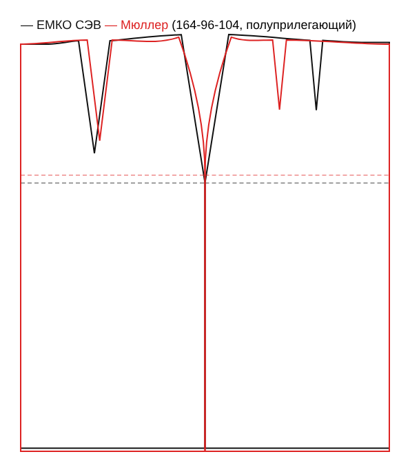
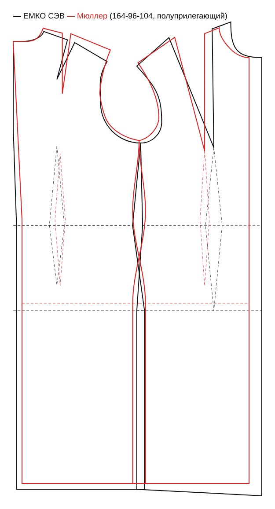
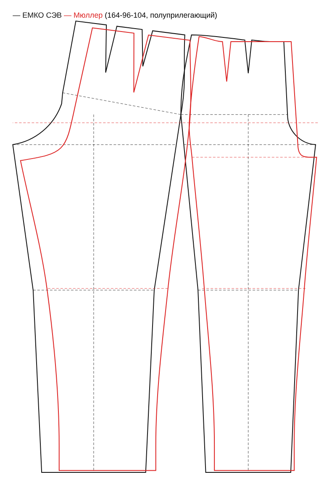

# M2. Основы по двум методикам: ход работы

## Прямая юбка, ЕМКО СЭВ (готово, сверено с учебником)

Цепочка целиком: мерки → расчёт по формулам → чертёж двух деталей → проверка срезов → PDF 1:1 на A4 или A0.

**Код:** `packages/core/src/blocks/emko/skirt.ts`, тесты `skirt.test.ts`. Вкладка «Выкройка» в прототипе.

**Источник:** «Единая методика конструирования одежды СЭВ», том 2 «Базовые конструкции женской одежды», юбка прямого силуэта, I вариант: таблица на с. 107, рис. 46 на с. 108. Номера точек — как в книге. Первая версия юбки (PR #8) была построена по пересказу методики (vflint.ru/node/68), когда тома ещё не было. Теперь она переделана по книге.

**Формулы** (Т — размерные признаки ОСТ 17-326-81 / ГОСТ 31396-2009, в книге см, в коде мм):

| Отрезок | Формула | Что это |
| --- | --- | --- |
| 41–51 | 0,65·(Т7 − Т12) + 0,75 + 0,2 | линия бёдер (Т7 высота талии, Т12 высота подъягодичной складки) |
| 51–57 | 0,5·Т19 + Пб | ширина половины юбки по бёдрам |
| 51–54 | 0,5·\|51–57\| | бок посередине: задняя и передняя половины равны |
| 94–441 − 41–91 | Т25 − Т7 − 1,05 | подъём талии у бока |
| 97–47 − 41–91 | Т26 − Т7 − 0,75 | подъём талии спереди |
| 41–470 | 0,5·Т18 + Пт | талия с прибавкой |
| dт | \|51–57\| − \|41–470\| | сумма вытачек половины юбки |
| 41–420, 47–460 | 0,1·\|41–470\| | у середин талия идёт горизонтально |
| 441–442 = 441–442′ | 0,26·dт | бок, срез прямой от 442 до 54 |
| 41–42; 42–521; 42–421 | 0,4·\|51–54\|; 0,8·\|41–51\|; 0,17·dт | задняя вытачка: ось, длина, половина раствора |
| 47–46; 46–561; 46–461 | 0,5·Т46 + 0,1; 0,5·\|41–51\|; 0,07·dт | передняя вытачка: ось от центра груди, длина, половина раствора |

**Прибавки** (к полуобхвату, мм). В книге для юбки только прямой силуэт: бёдра 21,5 (ПС 10 + ПП 6,2 + ПТ 5,3), талия 13,4. По умолчанию: прямой 13 / 22, полуприлегающий 10 / 15, прилегающий 5 / 10. Любую можно поменять в модели.

**Отличия от книги:**
- Длина юбки задаётся меркой Ди (сбоку), а не формулой книги до колена Т7 − Т9 + 0,75.
- Для примера 164-96-104 книга печатает dт = 14,40 см, хотя по её же формуле 54,20 − 39,35 = 14,85 см. Мы считаем по формуле, раствор вытачек выходит на 1–3 мм шире.
- Есть необязательное понижение талии посередине сзади (в книге 0).

**Мерки:** добавлена Впс (Т12, высота подъягодичной складки), она понадобится и для брюк. Мерка Дтб для юбки больше не нужна: линию бёдер книга строит от Т7 и Т12. Типовые значения Т7, Т12, Т25, Т26 для базовой фигуры 164-88-96 взяты из таблицы 11 тома 2 (ОСТ 17-326-81).

**Проверки:** боковые срезы задней и передней половин совпадают; длина талии юбки равна От + 2·Пт (±1,5 см), это длина пояса.

**Тесты-эталоны:** пример самой книги, размер 164-96-104 по таблице 11: все отрезки совпадают со столбцом «величина отрезка в чертеже» с точностью до 1 мм. Кроме того, юбка строится без ошибок проверки на всех 356 типовых фигурах ГОСТ 31396 в трёх силуэтах.

**Не входит в эту основу:** припуски на швы (M3), шлица, пояс.

## Платье с втачным рукавом, ЕМКО СЭВ (готово, сверено с учебником, нужен макет)

Заменяет лиф из PR #10, который был построен по пересказу методики (blogremaking). Код `packages/core/src/blocks/emko/dress.ts`, тесты `dress.test.ts`.

**Источник:** том 2 ЕМКО СЭВ, платье полуприлегающего силуэта: таблица 6 (с. 67–71, 73, 75), БК спинки и переда (рис. 29), ИМК вытачек (рис. 30), БК одношовного рукава (рис. 31). Номера точек как в книге.

**Детали:** спинка (крой 2, шов посередине), полочка со сгибом, одношовный рукав с вытачкой по локтю. Длина ниже талии задаётся меркой Ди. Детали без припусков.

**Как строится (коротко):**
- Сетка: глубина проймы Т39, талия Т40, бёдра 0,65·(Т7 − Т12). Ширины: спинка 0,5·Т47, пройма Т57, полочка 0,5·(Т45 + Т15 − 1,2 − Т14).
- Пройма: высоты 0,49·Т38 и 0,43·Т38, низ проймы двумя дугами радиусами 0,62 и 0,38 ширины проймы.
- Спинка: горловина 0,18·Т13 и 0,07·Т13, плечевая вытачка с углом β34 из таблицы 12 книги.
- Полочка: центр груди 0,5·Т46 и Т36 − Т35 от талии. Перед строится повёрнутым вокруг центра груди на нагрудную вытачку (хорда 0,5·(Т15 − 1,2 − Т14)). Точка плеча у шеи берётся по дуге Т44. Затем вытачка переводится в плечо в 4,5 см от шеи, как на рис. 30.
- Вытачки по талии: dт = |31–37| − |41–470|, делится 0,36 спинка / 0,24 бок / 0,40 перед. По бёдрам бок расширяется на dб.
- Рукав: ДП = 0,93·Т38 + …, ДОР = (1 + Н)·ДП, ШОР = Т57 + 4,5 + П, ВОР = 0,885·ДОР·√(0,25 − (ШОР/ДОР)²). Окат строится через точки 131, 134, 144, 14, 143, 142, 355, низ оката повторяет низ проймы. Книга чертит рукав сложенным; у нас он развёрнут по двум линиям сгиба. Шов идёт параллельно переднему сгибу (ИМК, рис. 32), разница срезов уходит в вытачку по локтю.

**Сверка:** на примере книги (164-96-104, мерки таблицы 11) все 33 отрезка таблицы совпадают со столбцом «величина отрезка в чертеже» с точностью до 1 мм. Кроме того, платье строится без ошибок проверки на всех 356 типовых фигурах ГОСТ в трёх силуэтах.

**Где пришлось додумать:**
- Т35 − Т34 (центр груди ниже линии Ог1): такой мерки в приложении нет. Оцениваем по таблице 12 как 0,1·Т16 + 0,5 см, на примере книги выходит 10,1 вместо 10,3.
- Угол плечевой вытачки: книга даёт 13,5° → 11,3°, но таблица 12 для этого размера даёт β34 = 13°, а члены формулы с прибавками в скане не читаются. Берём β34 по таблице 12 и уменьшаем на 2,2°, пропорционально прибавке по груди. Получается 10,8°.
- Длина плечевой вытачки 0,45·|122–32| (в книге 0,4–0,5). Положение вытачек по талии «по модели», взято с рис. 30.
- Книга печатает dт = 10,20 и dб = 2,30, хотя по её формулам выходит 9,85 и 2,65. Считаем по формулам.
- Линия низа рукава прямая, без скоса книги.
- Прибавки других силуэтов (прилегающий 3,5 / 2,5 / 2,5 см, прямой 6,5 / 10 / 6,5 см к полуобхватам груди, талии и бёдер) взяты по таблице 15 книги и подобраны. В самой книге есть только полуприлегающее платье.

**Проверки в приложении:**
- плечевые срезы равны;
- боковые срезы равны (±1 см);
- пройма по чертежу сравнивается с ДП по формуле (±3 см);
- окат минус пройма равен ПОР (±1,5 см);
- два среза шва рукава равны.

**Мерки:** Т32 и Т33 собираются из ширины плеча и длины руки до локтя или запястья. Мерки Впрп и Впк от старого лифа больше не используются. Типовые значения шеи, Ог2, ширины спины, Цг, Дтс, Т39, Т38 и Т44 для базовой фигуры взяты из таблицы 11 книги.

## Брюки, ЕМКО СЭВ (готово, сверено с учебником, нужен макет)

Код `packages/core/src/blocks/emko/trousers.ts`, тесты `trousers.test.ts`. Две детали: задняя и передняя половины (крой по 2), без припусков.

**Источник:** том 2 ЕМКО СЭВ, брюки полуприлегающего силуэта: таблица 9 (с. 98, 100–101), БК рис. 42, вытачки по ИМК рис. 43.

**Как строится (коротко):**
- Линия бёдер 0,65·(Т7 − Т12) − 2 от талии. Ширина 0,5·Т19 + П, сзади 0,53, спереди 0,47.
- Шаговые выступы: 0,665 и 0,335 от (0,2·Т19 − 2).
- Высоты считаются от пола: талия Т26 и Т25, линия шага Т27 + 3, колено Т9, низ 0,04·Т1 − 5.
- Стрелки проходят посередине половин. По колену 0,275 / 0,225·Т22 + П, по низу 0,275 / 0,225·Т51 + П.
- Задняя половина повёрнута вокруг точки 54 так, что её линия бёдер перпендикулярна линии бока 742–54.
- Средние швы строятся дугами. Прогиб сзади 68–681 = 1,5 см, в книге его выбирают от 0,5 до 3,5 см; это настройка модели.
- Вытачки по талии: dт = бёдра − талия. Две задние по 0,2·dт, бок по 0,2·dт на каждой половине, передняя 0,13·dт, середина переда 0,07·dт.

**Новые мерки:** Днв (Т27, длина ноги по внутренней поверхности) и Опс (Т51, обхват подъёма стопы). Т9 считается как Т7 − Дтк.

**Сверка:** на примере книги (164-96-104) все отрезки таблицы совпадают с точностью до 1,5 мм. Исключение — передний шаговый выступ: книга печатает 6,10 см, хотя по её формуле выходит 6,30 см; мы считаем по формуле. Брюки строятся на всех типовых фигурах ГОСТ в трёх силуэтах.

**Проверки:** боковые срезы равны (±1,5 см), шаговые срезы равны (±1,5 см), талия равна От + 2·Пт.

**Прибавки:** в книге брюки только полуприлегающие (бёдра 2,0, талия 2,15 см). Прибавки для прилегающих и прямых брюк подобраны.

## Прямая юбка, Мюллер (готово, сверено с книгой)

Код `packages/core/src/blocks/muller/skirt.ts`, тесты `skirt.test.ts`. Две детали: заднее и переднее полотнища (обе со сгибом), без припусков.

**Источник:** «М. Мюллер и сын. Основные конструкции. Сборник» (Библиотека журнала «Ателье», 2005), с. 1–4, рис. 1–4.

**Как строится (коротко):**
- Сетка: высота бёдер ВБ, ширина 0,5·ОБ + 1…2 см, бок ровно посередине.
- Талия 0,5·ОТ + 1 см. Сумма вытачек = бёдра − талия. Половина суммы (+0…1 см) уходит в бока, 1,5–2,5 см в переднюю вытачку, остаток в заднюю.
- Если сзади остаётся больше 3–4 см, строятся две задние вытачки: первая 3–4 см в 6 см от середины, вторая посередине до бока, а боковой шов вверху смещается на 0,5 см вперёд.
- Бок поднят на 1–1,5 см, стороны вытачек на 0,5–0,7 см. Вытачки параллельны серединам: передняя в 7 см от бока длиной 9,5 см, задняя посередине длиной 14 см.

**Чем отличается от ЕМКО:** у Мюллера нет мерок высоты талии спереди и сзади, поэтому линия талии прямая, поднят только бок. Линия бёдер берётся прямо из мерки ВБ, а не из Т7 − Т12. Задняя и передняя половины одинаковой ширины.

**Сверка:** пример книги (размер 40: ОТ 76, ОБ 100, ВБ 20,8) даёт 51 − 39 = 12 см: бок 7, перед 2, зад 3, как в книге. Юбка строится на всех типовых фигурах ГОСТ в трёх силуэтах.

**Новые мерки:** не нужны. Нужны От, Об, высота бёдер и длина юбки.

## Платье с втачным рукавом, Мюллер (готово, сверено с книгой, нужен макет)

Код `packages/core/src/blocks/muller/dress.ts`, тесты `dress.test.ts`. Три детали: спинка (крой 2, шов посередине), полочка (со сгибом), одношовный рукав (крой 2), без припусков.

**Источник:** сборник Мюллера, «Основной чертёж платья прилегающего силуэта, размер 48», с. 49–51, рис. 1–4.

**Как строится (коротко):**
- Сетка от 7-го позвонка: глубина проймы Гпр + 1 см, длина спины, высота бёдер, длина изделия. Середина спинки уходит внутрь на 2 см у талии.
- Ширины: спина ⅛Ог + 5,5, пройма ⅛Ог − 0,5, грудь ¼Ог − 5 (в сумме ½Ог) плюс прибавки.
- Перед выше спинки на (Ог − 100)/10 + 4,5 см. От точки груди (Вг = ¼Ог + 5) идёт нагрудная вытачка в плечо, в примере книги около 10 см.
- Плечевой шов смещён на 1 см вперёд. Вытачка на лопатки (1–1,5 см у проймы) переведена в плечо спинки.
- Талия: ½От + 2…3 см. Избыток сзади делится между боками (3–4 см) и вытачкой спинки (2–3,5 см), избыток спереди уходит в вытачку под грудью. Недостаток по бёдрам добавляется поровну к бокам.
- Рукав одношовный: высота оката = ½ высоты проймы по чертежу − (0,2·Шпр + 0,75). Ширина считается от длины проймы, рукав разворачивается по переднему и локтевому перекатам.

**Чем отличается от ЕМКО:**
- Мюллер строит основу на типовую фигуру: ширины, высота груди и длина переда выводятся из Ог, а не из отдельных мерок. Своих мерок нужно меньше: Ог, От, Об, длина спины, глубина проймы, высота бёдер, длина изделия, длина руки и обхват запястья.
- Пройма у Мюллера глубже. Его глубину проймы мы считаем как ГОСТовскую Впрз + 2,5 см: на типовой фигуре 164-96 это совпадает с его формулой ⅒Ог + 11.
- Посадка оката у Мюллера больше: 3,5–8 см на типовых фигурах ГОСТ против 3,7 см в ЕМКО. Для платья это много, поэтому есть настройка «Уменьшение оката».

**Отступления от книги:**
- Ширина рукава внизу = обхват запястья + 7,5 см (в книге 24 см без формулы).
- При развороте рукава излом локтевого переката даёт локтевую вытачку в шве. В книге шов нарисован без неё.
- Нагрудная вытачка доходит до самой точки груди, как в книге. Укорачивать её будем на этапе моделирования.

**Сверка:** пример книги (размер 48: Ог 110, От 94,5, Об 114) даёт ширины 19,7 / 14,8 / 24 см и контроль 58,5 см точно, как в книге. Высота проймы по чертежу 39,1 см (в книге 40), длина проймы 48,5 см (в книге 49), высота оката 15,8 см (в книге 16,3). Бока 3,4 см, вытачка спинки 2,8 см. Платье строится на всех типовых фигурах ГОСТ в трёх силуэтах.

**Проверки:** плечо спинки длиннее плеча полочки на 0,5–1 см, боковые срезы равны, посадка оката 2–8 см, два среза шва рукава равны (±8 мм без локтевой вытачки).

## Брюки, Мюллер (готово, сверено с книгой, нужен макет)

Код `packages/core/src/blocks/muller/trousers.ts`, тесты `trousers.test.ts`. Две детали: задняя и передняя половинки (крой по 2), без припусков.

**Источник:** сборник Мюллера, «Построение основы чертежа стандартных брюк», с. 6–9, рис. 1–7.

**Как строится (коротко):**
- Сетка от линии талии сбоку: высота сидения Вс, колено на 0,4·(Дсб − Вс) ниже линии шага, низ на 3–4 см выше пола (под каблук).
- Линия бёдер на 1/10·½Об + 3 см выше линии шага. Передняя половинка ¼Об − 1, шаг 1/10·½Об + 0,5…1.
- Задняя половинка строится на сетке передней. Сгиб сдвинут на 1,5 см к шагу, средний шов перпендикулярен линии 26–27, ширина ¼Об + 1 см. Колено и низ на 2 см шире передних с каждой стороны.
- Талия: по ¼От на половинку плюс вытачки (спереди 2, сзади 3,5 см). Середина сзади поднята так, что |13–36| = |13–35| − 0,5.
- Задний шаговый срез на 0,25 см короче переднего.

**Мерки:** От, Об, Дсб, высота сидения и обхват подъёма стопы. Ширина низа = Опс + 10 см (в книге 42 см для размера 40 без формулы).

**Сверка:** пример книги (размер 40: От 76, Об 100, Дсб 106, Вс 26,5) даёт Дш 79,5, Вк 31,8, ширины 24 и 26 см, низ 42 см, как в таблице книги. Брюки строятся на всех типовых фигурах ГОСТ в трёх силуэтах без предупреждений.

**Проверки:** боковые срезы равны (±1,5 см), задний шаговый на 0–0,5 см короче переднего, талия = От + 4·прибавка.

## Сравнение ЕМКО и Мюллера на одних мерках

Мерки взяты с типовых фигур ГОСТ, силуэт полуприлегающий. В скобках ЕМКО / Мюллер, мм. Чёрным на рисунках ЕМКО, красным Мюллер.

| | 164-88-96 | 164-96-104 | 170-108-114 |
|---|---|---|---|
| **Юбка:** линия бёдер от талии | 198 / 190 | 201 / 190 | 208 / 195 |
| сумма вытачек на половину | 135 / 135 | 133 / 133 | 125 / 125 |
| подъём талии у бока | 15 / 10 | 15 / 10 | 20 / 10 |
| **Платье:** линия груди от 7-го позвонка | 186 / 215 | 196 / 225 | 221 / 250 |
| ширина спины / проймы / груди | 186·129·208 / 175·125·185 | 199·139·228 / 185·135·205 | 219·154·260 / 200·150·235 |
| длина проймы | 432 / 437 | 459 / 464 | 501 / 524 |
| длина оката | 475 / 482 | 506 / 513 | 550 / 583 |
| высота оката | 146 / 149 | 157 / 157 | 172 / 178 |
| вытачка по талии сзади / спереди | 34·38 / 24·23 | 34·38 / 24·21 | 38·42 / 24·23 |
| **Брюки:** линия бёдер от талии | 170 / 187 | 173 / 193 | 180 / 213 |
| ширина передней / задней половинки | 235·265 / 230·255 | 254·286 / 250·275 | 277·313 / 275·300 |
| шаг спереди / сзади | 62·118 / 56·131 | 67·129 / 60·142 | 74·142 / 65·155 |
| шаговый срез | 787 / 757 | 783 / 747 | 808 / 763 |

**Что видно:**
- **Юбки** почти совпадают: ширина и сумма вытачек одинаковые, потому что одинаковы прибавки. Разница в мелочах. ЕМКО поднимает талию сбоку по меркам высоты талии (1,5–2 см), Мюллер всегда на 1 см. ЕМКО кладёт больше в заднюю вытачку, Мюллер больше в бок.
- **Платья** близки по силуэту, особенно пройма и окат: длины отличаются на 1–5 %. Линия груди у Мюллера на 3 см ниже, зато его пройма уже. Полочка и спинка у Мюллера уже, потому что в полуприлегающем силуэте у него меньше прибавка по груди: 4,5 см против 5,1 у ЕМКО. Вытачки по талии у Мюллера меньше, остальное он убирает в бока.
- **Брюки** отличаются сильнее всего. У Мюллера ниже линия шага: высота сидения берётся из мерки, а у ЕМКО выводится из высот. Шаговый срез у Мюллера на 3–4,5 см короче, из них 3,5 см — укорочение под каблук. У Мюллера больше задний шаг и меньше передний.

**Что дальше:** какая методика лучше сидит, покажет только макет. Предлагаю сшить обе юбки: построение у них самое простое, и разница видна сразу у бока и на задней вытачке.

## Чертёжный модуль

`packages/core/src/draft/geom.ts` — точки, прямые, засечки циркулем, плавные кривые, длины. Основы пишутся теми же шагами, что в учебнике, поэтому их легко сверить с ручным расчётом. FreeSewing оставлен для тестовой детали M0 и пригодится в M3 для припусков (offset кривых).
