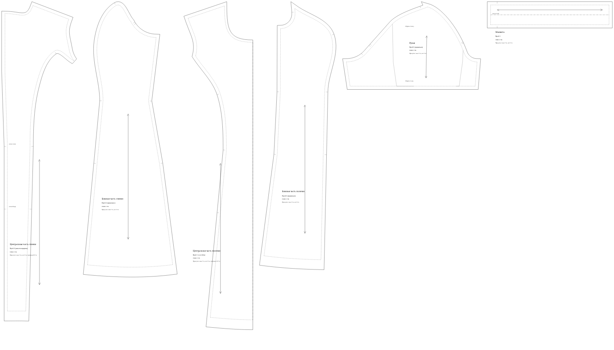
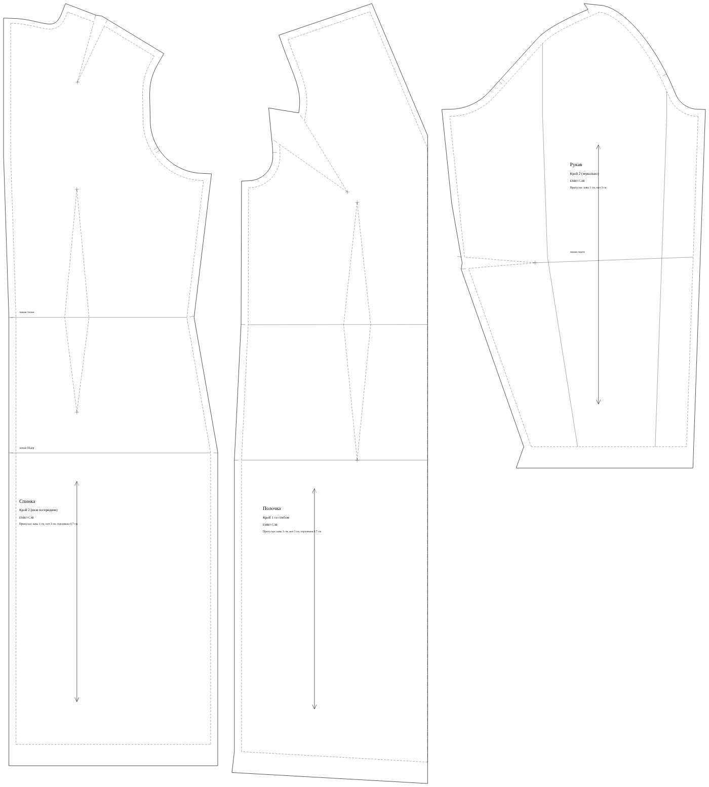
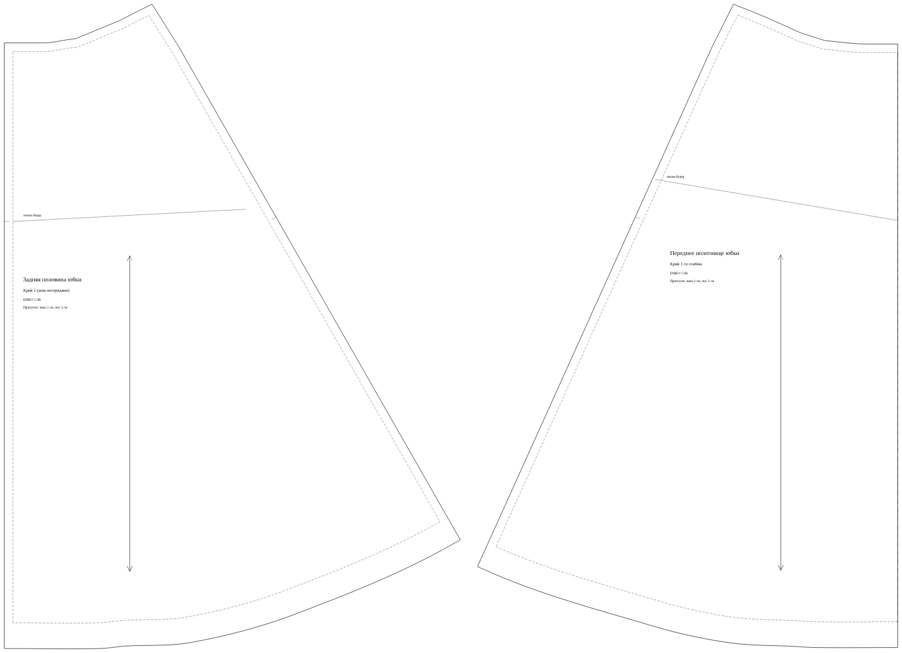

# M3. Моделирование, припуски, печать: ход работы

Цель этапа из плана: из основы за несколько минут получается платье с рельефами и рукавом-фонариком, и его можно распечатать и сшить.

**Итог:** во вкладке «Выкройка» платье ЕМКО или Мюллера примерно за дюжину полей превращается в платье с рельефами из проймы, круглой горловиной, расширением книзу и коротким рукавом-фонариком с манжетой. Детали печатаются с припусками на A4 (с метками склейки) или на A0. В автотесте вся форма заполняется за доли секунды; руками это 2–3 минуты. Сшить её пока не пробовали: это следующий шаг для швеи.

## Как устроено

**Детали с именованными срезами** (`packages/core/src/pattern/panel.ts`). Каждая из шести основ теперь отдаёт кроме чертежа ещё и «панели». Панель — это замкнутый контур из срезов с общими для всех методик именами: `neck`, `shoulder`, `armhole`, `side`, `hem`, `cb`, `cf`, `waist`, `princess`, `cap`, `seamFront`, `seamBack`, `inseam`, `crotch`. Вытачки на контуре хранятся как две стороны (`bust`, `shoulder`, `waist`, `elbow`), вытачки внутри детали («рыбки» на платье) — как четыре точки. Приёмы ищут срезы и вытачки по этим именам, поэтому один и тот же код работает и на ЕМКО, и на Мюллере (принцип 2 плана). Тест проверяет, что длины срезов панелей совпадают с длинами, которые посчитала основа.

**Модель = основа + методика + приёмы + параметры** (`pattern/model.ts`, принцип 1 плана). Приёмы применяются в постоянном порядке: вытачки → рельефы → горловина → длина → расширение → рукав. Модель, взятая как основа, добавляет новый слой приёмов поверх старых, поэтому её можно моделировать дальше.

## Приёмы (`pattern/ops.ts`)

| Приём | Что делает | Где |
| --- | --- | --- |
| Перевод вытачки | Нагрудная: в середину плеча, в пройму, в бок, в горловину, целиком или частью (две вытачки). Спинки: в пройму, в горловину. Поворачивается часть контура без середины переда или спинки, угол сохраняется | платья |
| Рельеф | Из проймы или из плеча, на полочке и/или спинке. Линия идёт от вытачки через центр груди и талиевую вытачку вниз до низа; каждая часть получает по одной стороне вытачек. Проверка: два среза рельефа равны (±1 см) | платья |
| Горловина | Круглая, V, каре; расширение по плечу (одинаково на полочке и спинке) и углубление спереди и сзади | платья |
| Длина | Удлинение или укорочение по линии посередине между бёдрами и низом (у брюк между коленом и низом); боковые срезы остаются согласованными | все |
| Трапеция и клёш | Юбка: вытачки по талии закрываются в низ (0–100 %), расширение по бокам, добавочный клёш по низу разрезами от талии. Платье: расширение по бокам и по рельефам от линии бёдер | юбки, платья |
| Рукав | Длина от верха оката (короткий рукав обрезается, локтевая вытачка убирается), фонарик по окату и по низу с подъёмом оката, манжета (отдельная деталь со сгибом) | платья |

## Припуски и оформление (`pattern/allowance.ts`)

- Припуск у каждого среза свой: по умолчанию швы 1 см, низ 3 см, горловина 0,7 см; всё меняется в модели. По сгибу припуска нет.
- Углы: припуски продлеваются до пересечения. Где боковой шов встречает низ под острым или тупым углом, угол припуска на подгибку зеркальный, чтобы подогнутый низ лёг по шву.
- Над вытачкой припуск выкроен «клювом»: такая форма ложится ровно, когда вытачка заутюжена (на центр у юбок, к горловине у плечевых).
- Нагрудная вытачка стачивается не до центра груди, а на 2 см раньше; на конце вытачки крестик.
- Надсечки: на линии талии и бёдер по бокам и рельефам, у колена на брюках, по краям вытачек, на пройме (полочка одна, спинка две) и на окате (в тех же местах с учётом посадки, плюс верх оката к плечевому шву), на центре груди по рельефу, по краям сборки у фонарика.
- Долевая нить, название детали, сколько кроить, название модели, методика, фигура (рост, Ог, От, Об) и припуски подписаны на каждой детали.
- Линия кроя сплошная, линия шва пунктиром. Тест проверяет на всех основах, что линия кроя отстоит от шва ровно на припуск (±1,5 мм), а на части типовых фигур ГОСТ — что у неё нет выбросов.

## Печать

PDF 1:1 на листах A4 с рамкой, именем листа (буква — ряд, цифра — столбец) и метками склейки, на первом листе контрольный квадрат 10 × 10 см; или на A0. Это было с M0, теперь печатается модель с припусками. Платье с рельефами и рукавом занимает 35 листов A4 (5 × 7) или 2 листа A0.

## Библиотека на устройстве

Новая вкладка «Библиотека» (IndexedDB, ничего не уходит с телефона):

- фигуры: сохранить текущие мерки под именем, открыть, удалить;
- свои основы («Сохранить как свою основу» во вкладке «Выкройка») и модели;
- «Открыть» пересчитывает модель по текущим меркам; «Взять как основу» начинает новую модель поверх сохранённой.

## Что не вошло и что дальше

- Подкройные обтачки горловины и пройм пока не строятся: горловину обрабатывают косой бейкой или обтачку снимают с детали вручную.
- Для широкой горловины на ЕМКО нагрудная вытачка у шеи мешает расширению больше чем на ~3,5 см: приложение предупреждает и предлагает перевести вытачку.
- Рельеф спинки из проймы: вершина плечевой вытачки выше проймы, поэтому линия рельефа идёт через точку на биссектрисе вытачки на уровне проймы. Стороны остаются равными, но форма лопаточной выпуклости немного сглаживается; проверить на макете.
- Нужен макет: швея шьёт платье с рельефами и фонариком по своим меркам, записываем правки.
