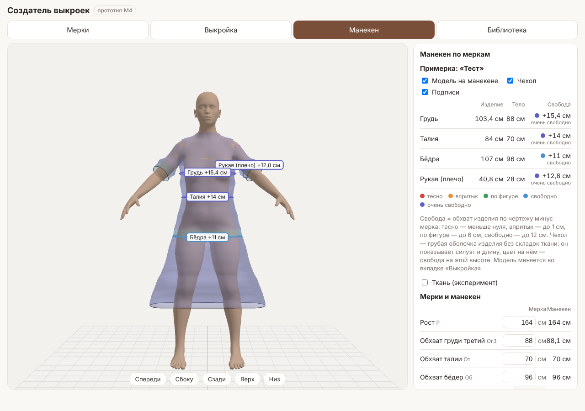
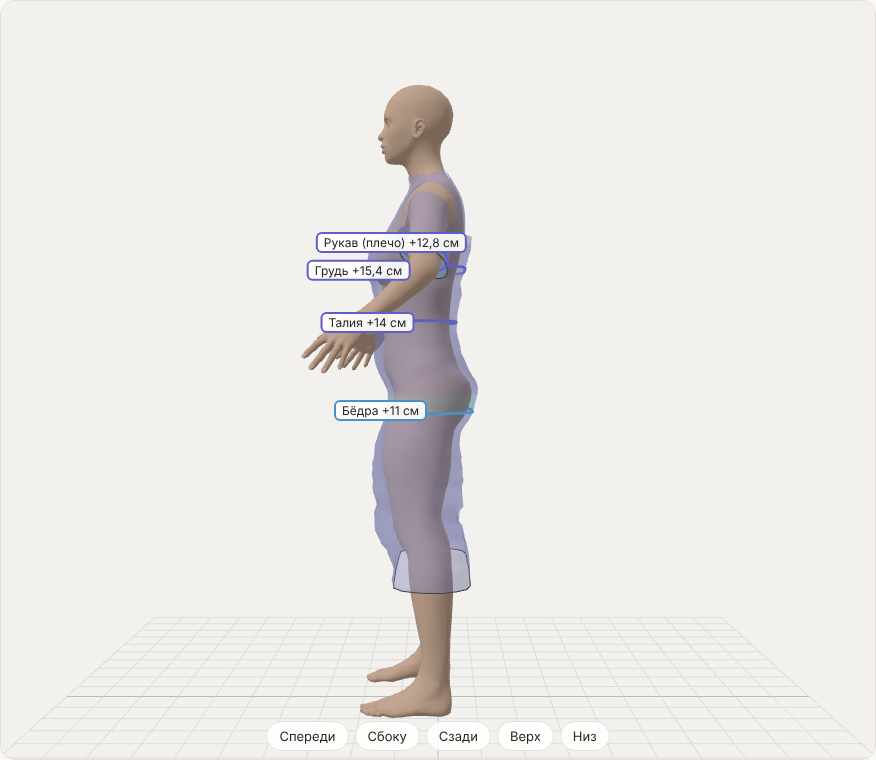
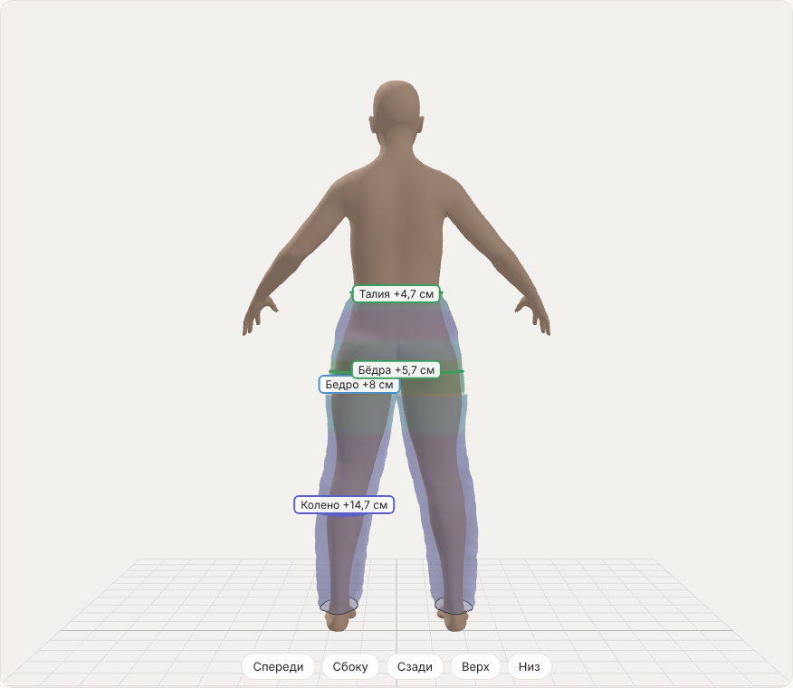
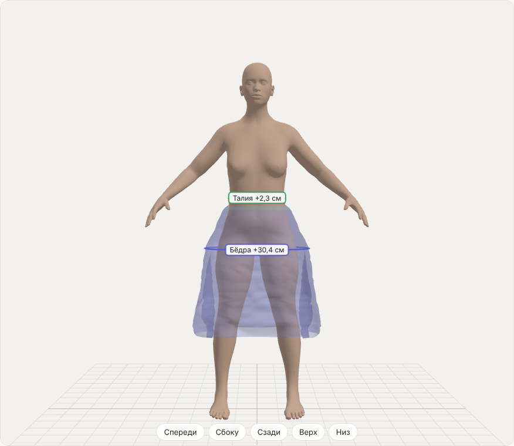

# M4. 3D-манекен и простая примерка: ход работы

Цель этапа из плана: манекен по меркам швеи визуально узнаваем, а карта облегания совпадает с ощущениями от макета.

**Итог.** Вкладка «Манекен» подгоняет тело Anny под одиннадцать мерок, надевает на него текущую модель из вкладки «Выкройка» полупрозрачным «чехлом» и показывает на поясах груди, талии, бёдер (у брюк ещё бедра и колена, у платья рукава), сколько сантиметров свободы даёт чертёж и что это значит: тесно, впритык, по фигуре, свободно. Манекен можно смотреть спереди, сбоку, сзади, отдельно верх и низ. Отдельным экспериментом юбку можно «уронить» простой симуляцией ткани. Вторую половину цели (карта совпадает с ощущениями) проверит только макет: платье из M3 швея ещё не шила.

## Манекен по меркам

В M1 манекен подбирался по росту и трём обхватам. Теперь (`packages/body/src/fit.ts`, `landmarks.ts`):

| Мерка | Чем подгоняется | Точность на типовых фигурах |
| --- | --- | --- |
| Рост | фенотип «рост» и масштаб | точно |
| Ог3, От, Об | фенотип «вес», местные изменения обхватов | до 0,5 см |
| Опг (под грудью) | фенотип «объём груди» (разница Ог3 − Опг) и местное изменение | до 1 см; при разнице больше ~13 см до 5 см |
| Ош, Оп, Обед | местные изменения шеи, плеча, бедра | до 1,5 см |
| Дтс | местное изменение «длина спины до талии» | до 1,5 см |
| Шп ≈ | местное изменение «ширина плеч» | до 2,5 см |
| Дтб ≈ | местное изменение «от талии до бёдер» | у Anny линия бёдер ниже: 2–5 см, не подгоняется до конца |

Как это устроено:

- **Ориентиры.** У Anny каждое местное изменение двигает свой набор вершин: кольцо шеи, плеча, бедра. Эти наборы на любом теле отмечают одно и то же место, поэтому служат ориентирами. Обхват руки меряется поперёк руки (руки у манекена разведены), шеи — у основания (где шея переходит в плечи), бедра — горизонтально на 3 см ниже промежности, под грудью — по складке под грудью, длина спины — от седьмого позвонка вниз по позвоночнику до линии талии.
- **Линия груди** теперь идёт через самые выступающие точки груди. Раньше бралась самая широкая часть, и у стройной фигуры она уходила вверх к подмышкам.
- **Подбор.** Несколько кругов метода секущих: в каждом круге по очереди подгоняется каждая мерка своим изменением, главные обхваты последними, чтобы они были точнее всего. На компьютере около 2 с. Подбор идёт в фоновом потоке (Web Worker), страница при этом не замирает.
- В таблице «Мерки и манекен» видно все одиннадцать мерок и что получилось на манекене. Мерки, которых швея не вводила, берутся по типовой фигуре (как во вкладке «Выкройка») и показаны серым.

## Карта облегания

`packages/core/src/fitmap/`. На любой высоте приложение складывает ширину всех деталей модели поперёк горизонтальной линии, вытачки при этом в ширину не входят, и умножает на два (каждая деталь — половина: со сгибом или кроится дважды). Получается обхват готового изделия. Он сравнивается с меркой:

- грудь — на уровне вершины нагрудной вытачки (выше неё вытачка на чертеже ещё открыта);
- талия — у платья по линии талии, у юбки и брюк — длина пояса (вытачки закрыты);
- бёдра, у брюк ещё бедро (3 см ниже шагового шва) и колено;
- рукав — сразу под проймой против обхвата плеча; фонарик и манжета учитываются.

Оценка: меньше нуля — тесно, до 1 см — впритык, до 6 см — по фигуре, до 12 см — свободно, больше — очень свободно. Это тот же цвет на поясах, в таблице и на чехле.

## Чехол

`packages/body/src/shell.ts`. Грубая оболочка изделия без физики:

- ниже подмышек — стопка колец: на каждой высоте берётся «лента» тела (выпуклая оболочка среза; под юбкой — обеих ног вместе) и раздувается от центра до обхвата изделия на этой высоте. Где изделие не больше тела, кольцо лежит на теле;
- плечи платья — поверхность тела, отодвинутая на 5 мм, без рук и головы;
- рукав — кольца поперёк руки от плечевой точки;
- у брюк — каждая штанина отдельно.

Высоты чертежа ложатся на манекен по линиям талии и бёдер. Чехол показывает силуэт (трапеция, клёш, длина, фонарик), а цвет на нём — свободу на каждой высоте. Складок ткани в нём нет.

## Что карта уже нашла

- **Клёш по рельефу в ЕМКО съедал бёдра.** Две ошибки M3. Первая: при прямом низе проверка «срез поворачивается наружу или внутрь» была лотереей, и боковая часть полочки ЕМКО сужалась вместо расширения. У прилегающего платья с рельефами и расширением свобода по бёдрам была −8 см вместо +5. Вторая: рельеф поворачивался от линии талии, прямая линия срезала изгиб по бёдрам, и даже в нужную сторону бёдра теряли до 3 см. Исправлено: рельеф расширяется от линии бёдер, как и боковые швы, а направление проверяется в точке над низом. Тест следит, чтобы расширение не уменьшало бёдра.
- **ЕМКО по груди свободнее Мюллера.** На фигуре 164-88-96 (полуприлегающий силуэт) платье ЕМКО даёт по линии груди +15 см, Мюллер +9,5 см. Ширина сетки ЕМКО у нас 52,3 см на половину фигуры против 44 + 5,1 по формуле «Сг3 + Пг»: в ширину полочки входит раствор нагрудной вытачки. Это может быть и правильно (так в учебнике), и признаком ошибки в формуле ширины полочки. Проверить на макете: если платье ЕМКО по груди заметно свободнее, чем по Мюллеру, это ошибка в ядре.

## Спайк: ткань

`packages/body/src/cloth.ts`, флажок «Ткань (эксперимент)» во вкладке «Манекен». Юбочная часть чехла становится тканью: точки — вершины колец, связи — длины по чертежу (растяжение, сдвиг, мягкий изгиб), строки до линии бёдер держатся на теле, остальное падает под тяжестью и не проходит внутрь тела. Клёш опускается и ложится складками; длина держится.

| Где | Точек | Шаг (8 итераций) |
| --- | --- | --- |
| Компьютер (Chromium) | ~1 800 | 9 мс |
| Эмуляция слабого телефона (процессор ×4 медленнее) | ~1 800 | 37 мс |

**Вывод.** Одна юбка на телефоне — 25–30 кадров в секунду, этого хватает для «уронить и посмотреть», но не для всей модели сразу. Для настоящей примерки (весь наряд, ткань с плотностью и жёсткостью, рукава) понадобится вычисление на видеокарте (WebGPU) или в WebAssembly, плюс столкновения с телом не по кольцам, а по поверхности. По M0 настоящий телефон Платона был примерно в 5 раз быстрее эмуляции, так что цифры выше — с запасом. Решение, делать ли примерку с физикой, лучше принимать после M5.

## Что не вошло и ограничения

- Чехол без складок и без натяжения: он показывает силуэт, а не то, как ткань ляжет.
- Окат рукава на чехле окрашен как рукав под проймой: окат вшивается в пройму и не охватывает руку, сравнивать его с обхватом нечестно.
- Длины рук и ног, центр груди, ширина спины и груди на манекене не подгоняются: у Anny нет для них отдельных изменений.
- Манекен стоит в одной позе (руки разведены). Обхваты рук при этом меряются поперёк руки, так что на цифры поза не влияет.

## Как проверить на макете (M5)

1. Швея вводит свои мерки, открывает вкладку «Манекен» и проверяет, узнаёт ли себя (пропорции, грудь, бёдра) и совпадают ли цифры в таблице.
2. Для сшитого макета записываем по каждому поясу: что показала карта и как сидит на самом деле (тесно, по фигуре, свободно; сколько сантиметров можно защипнуть).
3. Если карта и ощущения расходятся на одном и том же поясе у разных людей, значит, неверна прибавка или формула в ядре.
